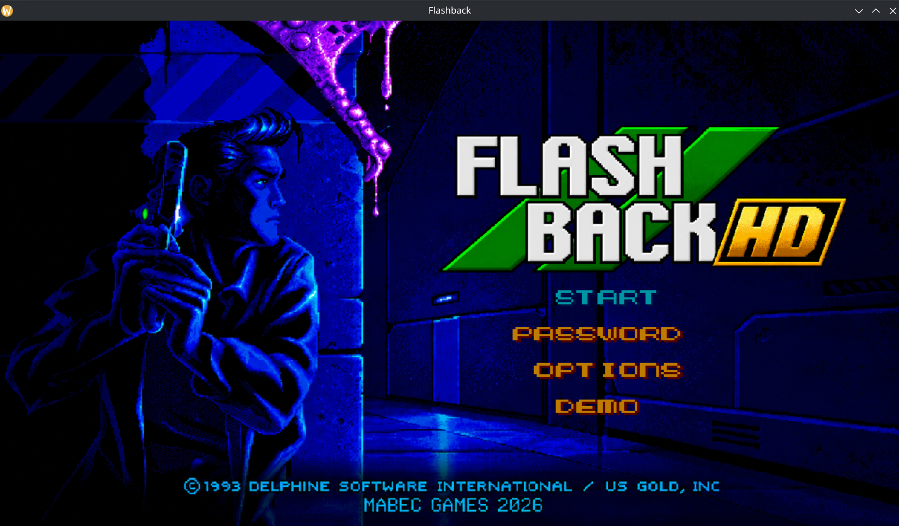
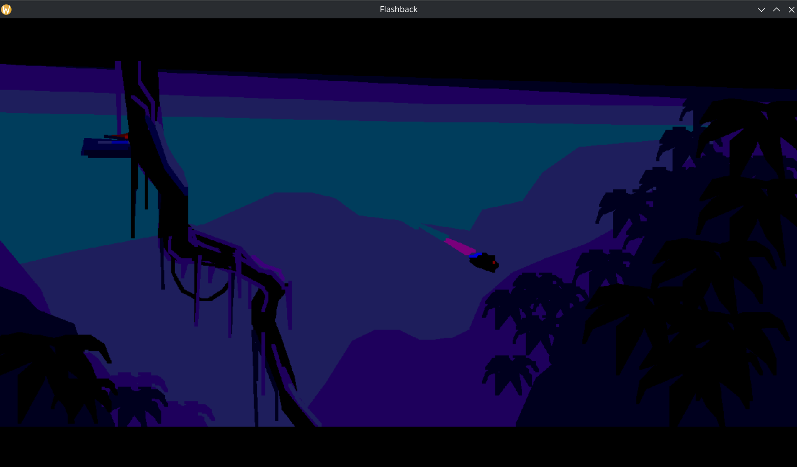
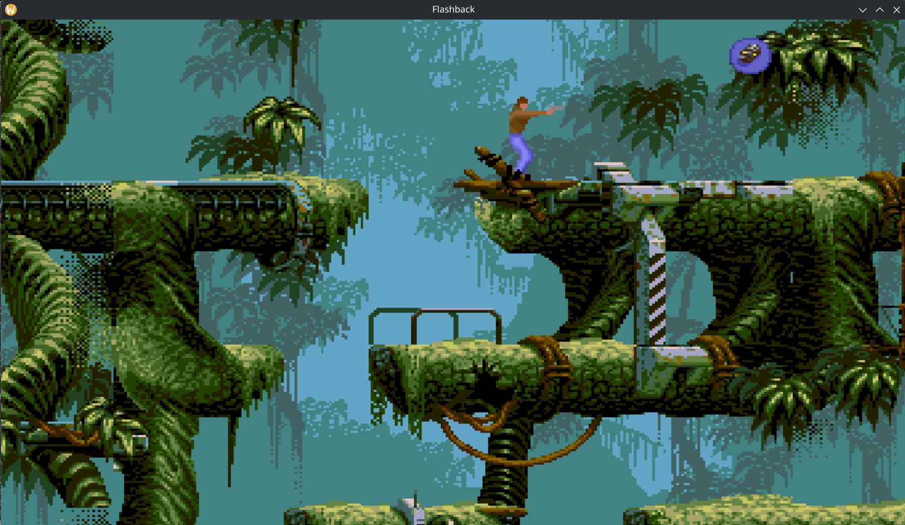

# Flashback HD

**Work in progress · Source only · No downloadable build available**

An experimental project based on the **SNES version of Flashback: The Quest
for Identity**, built on [snesrecomp](https://github.com/RetroPortingToolKit/snesrecomp).
It explores 16:9 widescreen gameplay, re-drawn cutscenes, and faster room loading
while keeping the original gameplay pixel art.

**This project probably will not be completed by its current maintainer.**
The original game's rooms, artwork, and transitions were designed for a 4:3
screen. Expanding that design to 16:9 exposes room boundaries and artwork that
was never intended to join into a continuous wide scene. The current approach
works as an experiment, but still has limitations that need more work.

**Anyone interested is welcome to fork the code and take over development**,
subject to the included license. There is no promise of further updates,
support, or a finished release. This repository shares the current source and
research so someone else can continue from here.

## Screenshots

### Main menu

The custom Flashback HD title screen. The background and logo are included
in `assets/hd/title/` and copied beside the executable automatically when
you build. See [HD pack setup](docs/HD_PACK.md).



### “Improved” and re-drawn cutscenes — 16:9 widescreen

The original cutscene shapes are captured and re-drawn at a higher resolution
for the widescreen presentation. This is experimental, and the original SNES
cutscene pacing is retained by default.



### Widescreen gameplay

The original pixel art is preserved. Neighbouring-room snapshots fill the
side areas, and room transitions occur at the widescreen edges. Those side
areas are cached images, not fully live extensions of the current room.



## What is implemented

- A running prototype with 16:9 presentation.
- HD title-screen replacement support and higher-resolution cutscene shapes.
- Neighbouring-room capture, a disk cache, and widescreen room transitions.
- Improved audio mixing through the framework's shadow mixer.
- A native C room painter to reduce loading stalls.
- Research tools, diagnostic switches, and engine notes for further work.

Recorded level-one checks found matching painted image data between the
native painter and the interpreted routine. Measured painting calls dropped
from approximately 650–1,050 ms to around 1 ms. This is a routine-level
improvement, not a claim that every room loads instantly or that the whole
game has been validated. See [work notes](NOTES.md) for measurements and limits.

## Build and test run (Linux)

**No prebuilt executable is provided.** You must build locally and supply your
own legally obtained ROM. ROMs, generated ROM-derived C, saves, and build
outputs are not included.

You need Git, Bash, Python 3, Rust/Cargo, CMake 3.20 or newer, a C/C++ compiler,
and SDL development dependencies. SDL3 is the default; SDL2 is also supported.
See the framework's [build documentation](snesrecomp/README.md) for dependencies.

From the root of your clone:

```bash
# Fetch the framework at the pinned revision.
git submodule update --init --recursive

# Apply the local framework changes once, on a fresh checkout.
git -C snesrecomp apply ../patches/framework-current.patch

# Set this to your own ROM's absolute path, keeping the quotes.
export SNESRECOMP_ROM="/absolute/path/to/Flashback - The Quest for Identity (USA) (En,Fr,De).sfc"

# Verify the ROM and generate the local recompiled source.
bash tools/regen.sh --rom "$SNESRECOMP_ROM"

# Build and launch. Launch only if the build succeeds.
cmake -S . -B build -DCMAKE_BUILD_TYPE=Release && \
cmake --build build -j"$(nproc)" && \
./build/FlashbackSNESRecomp "$SNESRECOMP_ROM"
```

For SDL2, add `-DSNESRECOMP_SDL_BACKEND=SDL2` to the CMake configure command.
Do not apply the older individual framework patches as well as the consolidated
patch above.

For subsequent test runs after a successful setup:

```bash
export SNESRECOMP_ROM="/absolute/path/to/Flashback - The Quest for Identity (USA) (En,Fr,De).sfc"
cmake --build build -j"$(nproc)" && \
./build/FlashbackSNESRecomp "$SNESRECOMP_ROM"
```

The native room painter is enabled by default. To compare with the original
interpreted painter:

```bash
FLASHBACK_PAINT_NATIVE=0 ./build/FlashbackSNESRecomp "$SNESRECOMP_ROM"
```

The supported ROM is the USA `(En,Fr,De)` revision, CRC32 `1e6aceba`,
SHA-256 `064a880a8dfcf576f74ae8a17c3ec7b0a27e8cb0300a5e5959452fcc30422f14`.
The generation script verifies it before producing code.

## Continuing development

Start with [NOTES.md](NOTES.md) for the latest implementation and validation
notes, [HD_PACK.md](docs/HD_PACK.md) for presentation settings, and the
[research tools](tools/research/README.md) for engine analysis. The research
roadmap contains historical ideas and may lag behind the work notes.

Useful next steps include testing later levels, checking room boundaries and
cached neighbours, investigating the remaining load pauses, and deciding how
far the original 4:3 room design can reasonably be adapted to widescreen.

The source snapshot includes the latest native painter and a consolidated
patch for the local framework modifications. No release workflow is enabled.
The executable retains the internal name `FlashbackSNESRecomp`.

## Credits and license

Flashback is the original game by Delphine Software. This is an unofficial
fan project, with no affiliation or endorsement implied.

The existing [PolyForm Noncommercial license](LICENSE) and attribution are
preserved. Forks and continued development must respect those terms and the
framework's own licenses. The code license does not grant rights to the
original game or its artwork. Screenshots document the prototype. The replacement title background and logo
are included; the original ROM and a prebuilt game are not.
